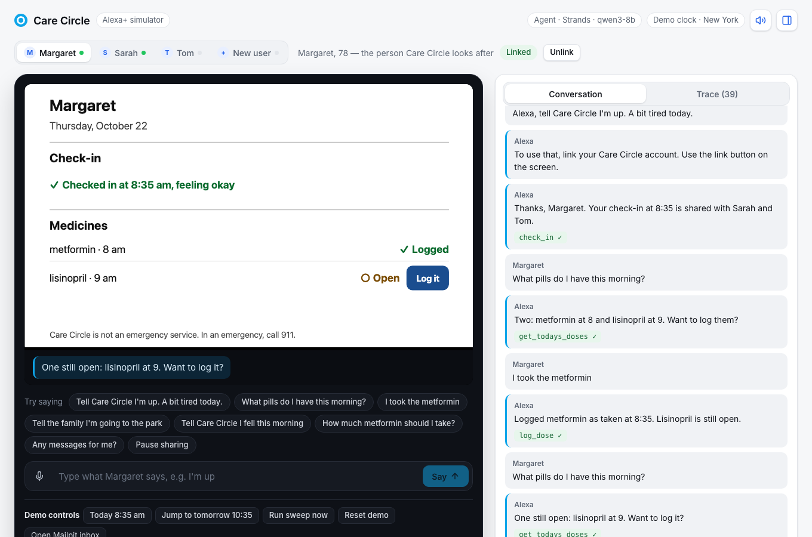
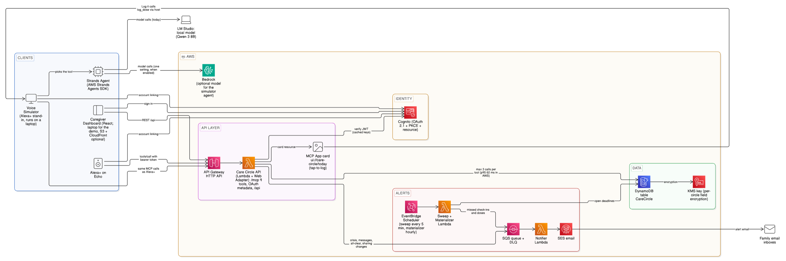

# Care Circle

**A daily check-in and medicine log for older adults who live alone, shared with their family through Alexa+.** Built as a self-hosted MCP server (MCP 2025-11-25, Streamable HTTP) for the Alexa+ track of Amazon's Build, Ship, Shape hackathon.



> Care Circle only knows what someone tells it. It is not an emergency service; in an emergency, call 911.
> This is not a substitute for professional medical advice. Consult a healthcare provider for personal medical decisions.

---

## The problem

- **63 million US adults** (nearly 1 in 4) are family caregivers. Over half manage medical tasks such as medication, but only 20% have training for it. ([AARP and National Alliance for Caregiving, July 2025, via AHA News](https://www.aha.org/news/headline/2025-07-25-63-million-americans-are-family-caregivers))
- **26.3% (4.9 million)** of Medicare Part D enrollees aged 65+ on blood-pressure medicine did not take it as directed in 2014 ([CDC MMWR](https://www.cdc.gov/mmwr/volumes/65/wr/mm6536e1.htm)); nearly 25% of new blood-pressure prescriptions are never filled ([CDC Vital Signs](https://archive.cdc.gov/www_cdc_gov/vitalsigns/blood-pressure/index.html)).
- **Amazon retired Alexa Together.** Support ended June 25, 2024 ([Amazon forum](https://www.amazonforum.com/s/question/0D56Q0000DKo8aKSQR/alexa-together-discontinued-how-to-manage-as-a-remote-caregiver)); Amazon's launch post now says it is no longer available ([About Amazon](https://www.aboutamazon.com/news/devices/alexa-together-launches-to-help-customers-remotely-care-for-loved-ones)). And Alexa+ policy rejects add-ons that collect device or usage data ([Policy Requirements](https://developer.amazon.com/docs/alexaplus/add-ons/policy-requirements.html)), so passive activity tracking can't come back. Care Circle uses explicit, spoken check-ins instead.

## What it does

**J1 — Setup.** Sarah (daughter, 300 miles away) creates a circle for her mother Margaret on the dashboard, adds two medicines, and makes a join code. Margaret says *"Alexa, tell Care Circle my code is 482159."* She isn't linked yet, so the server returns 401 and Alexa runs account linking. Care Circle reads back what will be shared and with whom; Margaret says "yes" and joins.

**J2 — Morning check-in**
> **Margaret:** Alexa, tell Care Circle I'm up. A bit tired today.
> **Alexa:** Thanks, Margaret. Your check-in at 8:35 is shared with Sarah and Tom.

**J3 — Medicines**
> **Margaret:** What pills do I have this morning?
> **Alexa:** Two: metformin at 8 and lisinopril at 9. Want to log them?
> **Margaret:** I took the metformin.
> **Alexa:** Logged metformin as taken at 8:35. Lisinopril is still open.

**J4 — Family asks**
> **Sarah:** Alexa, ask Care Circle how Mom's doing.
> **Alexa:** Margaret checked in at 8:35, feeling okay, and left a note on your dashboard. One of two medicines today is logged; lisinopril is still open.

(The note itself is never read aloud to a caregiver; it is only on the signed-in dashboard.)

**J4b — Family writes back**
> **Sarah:** Alexa, tell Mom I'll call at 6.
> **Alexa:** Got it. I'll pass that on to Margaret the next time Margaret talks to Care Circle.

Next morning:
> **Margaret:** Alexa, tell Care Circle I'm up.
> **Alexa:** Thanks, Margaret; your check-in at 8:35 is shared with Sarah and Tom. Sarah left you a message: "I'll call at 6."

No new tool and no push: the same `message_circle` tool, and the message rides along on Margaret's next check-in (or "any messages for me?"). It's read only to Margaret, never to other family members.

**Tap-to-log.** On an Echo Show, the card's **Log it** button calls the same `log_dose` tool as the voice command, through the MCP Apps host (`callServerTool`). Only the cared-for person's own card offers it.

**J5 — Silence becomes an email.** No check-in by 10:30 (window end + 30 min grace) → within 5 minutes Sarah and Tom get *"Margaret hasn't checked in today."* A late check-in sends a short all-clear.

**J6 — Crisis wording**
> **Margaret:** Tell Care Circle I fell this morning.
> **Alexa:** I'm sorry, Margaret; if you're hurt or need help now, call 911. I'm letting Sarah and Tom know.

The 911 (or 988 for self-harm wording) redirect is always spoken first; then the family gets an immediate email. Care Circle never judges severity.

## How it meets the Alexa+ track

| Requirement | How Care Circle does it | Proof |
| --- | --- | --- |
| MCP SDK imported **and called** at runtime | `@modelcontextprotocol/server` v2 (`McpServer`, `WebStandardStreamableHTTPServerTransport`, `createMcpHandler`); the simulator and tests use `@modelcontextprotocol/client` | [`packages/mcp-server/src/mcp`](packages/mcp-server/src/mcp) |
| MCP **2025-11-25** over **Streamable HTTP** at `POST /mcp` | Stateless, JSON responses (no SSE dependency); also accepts `2025-03-26`, which Amazon's sample sends | `tests/contract/mcp.test.ts` initializes with both |
| `initialize`, `tools/list`, `care_circle_help` without a token | Auth gate reads the JSON-RPC body **before** the transport | contract tests |
| Protected tools without a valid token → **HTTP 401, no `WWW-Authenticate`** | Same gate; expired/forged/wrong-audience tokens too | 8 contract tests + auth lifecycle |
| PRM at `/.well-known/oauth-protected-resource`; RFC 8414 metadata with `S256` | Served; in the cloud our API hosts the RFC 8414 facade in front of Cognito | contract tests |
| OAuth 2.1 code + PKCE + `resource` + refresh tokens; bearer in header only | Local dev authorization server (same flow), Cognito in the cloud; the simulator links like Alexa: 401 → PRM → AS metadata → PKCE with `resource` → retry | `tests/contract/auth-lifecycle.test.ts` |
| Stateless | No `Mcp-Session-Id`; a fresh server per request; tools return stable IDs (`dose_id`) | contract test checks no session header |
| Every tool result: speech text, then JSON text; `structuredContent` with `speech`; `outputSchema`; business errors as `isError: true` | One envelope builder for all 9 tools; outputs validated against their declared schemas with Ajv | contract tests |
| **MCP Apps** card | `ui://care-circle/today` (single-file HTML, `text/html;profile=mcp-app`) on `get_status` and `get_todays_doses`; renders only from `structuredContent`, so card and speech never disagree | MCP Inspector `--app-info`, simulator |
| **Agent Skill** | [`skills/care-circle/SKILL.md`](skills/care-circle/SKILL.md); the Strands and Bedrock agents use it as their system prompt | — |
| Context-aware add-on that keeps state across sessions | Check-ins, dose logs, week summaries, join codes, missed-deadline sweeps | — |
| Latency < 500 ms | No model calls in tools; ≤ 3 single-partition DynamoDB calls (usually 2) + 1 optional SQS send | in AWS: p50 **36 ms**, p95 **62 ms**, p99 **85 ms** (below) |

### The 9 tools

`care_circle_help` · `join_circle` · `check_in` · `get_todays_doses` · `log_dose` · `message_circle` · `get_status` · `get_week_summary` · `set_sharing`

Each description starts with what it does, then "Use for:" with real phrasings; enums carry synonyms (`mood`: *good = great, fine…; okay = so-so, a bit tired…*).

## Architecture



A spoken check-in: the client posts `tools/call check_in` with a bearer token → the auth gate verifies the JWT locally (cached keys) → one GSI1 query for membership and circle settings → one conditional update of today's check-in → (crisis wording only) one SQS send → reply. Family messages both ways, tap-to-log, the data model and the agent design are in [docs/architecture.md](docs/architecture.md).

## Run it locally (one command)

Requirements: Docker. Then:

```bash
docker compose up
```

Open the **simulator** at http://localhost:5174, the **dashboard** at http://localhost:5173, and the **email inbox** (Mailpit) at http://localhost:8025. The demo circle (Margaret, Sarah, Tom, 14 days of history) is loaded on start.

In the simulator: pick **Margaret**, click a suggestion such as *"Tell Care Circle I'm up. A bit tired today."* The first protected call returns 401; click **Link account** and sign in as Margaret on the dev sign-in page; the simulator retries. Use **Demo controls → Jump to tomorrow 10:35 → Run sweep now** to see J5's email in Mailpit.

Without Docker for the Node services (DynamoDB Local and Mailpit still run in Docker):

```bash
npm install
npm run dev            # creates .env with fresh local keys, the table, the demo data, and starts everything
```

### The simulator's agent (who plays Alexa+)

Alexa+ uses its own model to pick an add-on's tools; the simulator needs something in that seat. Three choices, set with `SIM_AGENT`:

| `SIM_AGENT` | What picks the tools | Notes |
| --- | --- | --- |
| `strands` | An [AWS Strands Agents](https://strandsagents.com) agent with the Agent Skill as its prompt and Care Circle's MCP tools | Model is a setting: `SIM_MODEL_PROVIDER=lmstudio` with `SIM_MODEL_ID=qwen/qwen3-8b` (any local model behind [LM Studio](https://lmstudio.ai)'s OpenAI-compatible server), or `SIM_MODEL_PROVIDER=bedrock` with `SIM_MODEL_ID=us.anthropic.claude-haiku-5-5` |
| `scripted` (default) | Regex rules | No model; the fixed suggestion phrases |
| `bedrock` | Hand-written Bedrock Converse loop | Kept for comparison |

```bash
# LM Studio running with qwen/qwen3-8b loaded and its server on :1234
SIM_AGENT=strands npm run dev
```

The Strands agent calls one Care Circle tool per turn and speaks Care Circle's reply as written, so the voice rules hold whatever the model. **Injury and self-harm wording never depends on the model:** the agent runs Care Circle's deterministic crisis matcher first and goes straight to `check_in`, so the 911/988 redirect and the family email always happen. (Small local models tend to answer those phrases themselves instead of calling a tool.) We ran it on a local Qwen model because Bedrock was blocked on our new AWS account; switching is the one setting above.

## Deploy to AWS

CDK v2 stacks in [`infra/`](infra/README.md): DynamoDB + KMS, Cognito (managed login, resource server, static clients), the API in Lambda via the AWS Lambda Web Adapter behind API Gateway, SQS + notifier + EventBridge Scheduler + SES, and S3 + CloudFront for the web apps. `npm run cdk -- synth` builds everything; deploying is a deliberate two-step process. Step-by-step guide, with CLI commands and what each step does: [`infra/DEPLOY.md`](infra/DEPLOY.md).

**Deployed and verified in us-east-1 (Oct 20–23, 2026).** Over a live HTTPS MCP endpoint: Alexa-style account linking against Cognito (401 → PRM → RFC 8414 → PKCE with `resource` → retry; Cognito accepts `resource` at both endpoints, so no proxy), check-ins, dose logs, tap-to-log, family messages both ways, the crisis redirect, and real SES emails for missed check-ins, missed medicines, urgent wording, messages and the all-clear. The simulator drove it with the Strands agent on a local model. Notes and messages are KMS-encrypted per circle. The stacks are torn down after recording to keep costs at zero.

## Test results

| Gate | Command | Result |
| --- | --- | --- |
| Lint and types | `npm run lint && npm run typecheck` | 0 errors |
| Unit (tool handlers, roles, crisis, DST, materializer, sweep idempotency, notifier dedupe, copy lint, log redaction, Strands agent) | `npm test` | **315 / 315 pass**; core coverage 81% statements / 83% lines |
| MCP contract (both protocol versions, schemas valid, every tool callable, `isError`, 401 without `WWW-Authenticate`) | `npm run test:contract` | **36 / 36 pass** |
| Auth lifecycle (link → use → expiry → refresh → unlink → other account) | `npm run test:contract` | pass; no data crosses accounts |
| MCP Inspector CLI (`--strict` schemas, unauthenticated help, MCP App metadata, resource) | `npm run test:inspector` | **4 / 4 pass** |
| Voice routing (60 phrasings + 22 loose everyday phrasings) and crisis (20 crisis + 20 near-misses) | `npm run test:voice` | **Strands agent (Qwen 3 8B, local): 59/60, loose 22/22**, crisis 20/20, 0/20 near-misses; scripted agent: 60/60, loose 12/22 |
| Latency (local, 10 concurrent, 100 calls per tool) | `npm run test:latency` | worst p95 **28 ms**, worst p99 **30 ms** (targets 300 / 450) |
| Latency (AWS, API Gateway's own `Latency` metric; 5 tools, warm) | `npm run test:latency` + CloudWatch | one at a time (530 calls): p50 **36 ms**, p95 **62 ms**, p99 **85 ms**; 10 at a time (885 calls): p50 **38 ms**, p95 **65 ms**, p99 **140 ms**; 0 errors. A cold start adds 0.65–0.94 s to the first call on a new Lambda environment |
| Accessibility (axe: card, dashboard, simulator) | `npm run test:a11y` | **0 serious or critical issues** |
| k6 (20 VUs, 2 min, cloud) | `npm run test:load` | script ready; not run (AWS-side numbers above come from the same tools via CloudWatch) |

The scripted agent's router was developed against the same 60 phrasings, so its 60/60 isn't independent; on 22 loose, everyday phrasings it gets 12. The ≥ 90% target is for a model-driven agent: the Strands agent scores 59/60 and 22/22 (`SIM_AGENT=strands npm run test:voice`, about 1 s per phrase on a laptop).

## Known limitations

- **Not on a real Echo yet.** Amazon's MCP Toolkit and Web Simulator aren't open to hackathon entrants, so `apps/simulator` stands in for Alexa+ (same MCP calls, account linking and card host). The server is ready to register as an add-on.
- **The simulator's model ran locally.** Our new AWS account is still in verification: Bedrock calls return "Operation not allowed" and CloudShell won't start. The Strands agent ran on Qwen 3 8B in LM Studio; Bedrock is one setting away (`SIM_MODEL_PROVIDER=bedrock`).
- **Latency from far away.** Inside AWS a tool call takes about 36 ms (p50); from a laptop in India the same call takes about 300 ms, because of the round trip to us-east-1. Alexa+ calls from Amazon's cloud.
- **Cold starts.** The first call on a new Lambda environment takes 0.65–0.94 s longer. Provisioned concurrency would keep environments warm at a small cost; we left it off.

## Safety and privacy by design

- **No emergency claims.** Never "monitor", "keeps … safe", or "detects falls". Every help reply and email says it isn't an emergency service and to call 911.
- **Crisis redirect first.** A deterministic matcher ([`packages/core/src/crisis.ts`](packages/core/src/crisis.ts)) with near-miss tests ("fell asleep", "stroke of luck"): injury wording → "call 911", self-harm wording → "call or text 988"; then the family is emailed.
- **No medical content.** Medicines are a name, nicknames and times. No dosage, strength or drug information; dosing questions get "ask your pharmacist or doctor".
- **Caregivers never hear notes.** Notes and messages are encrypted per field (KMS / AES-GCM) and shown only on the signed-in dashboard. Alexa speaks in a room; a note like "dizzy again" shouldn't be announced to whoever is nearby. Messages from her also go to the family by email.
- **The agent can't skip the crisis redirect.** In the simulator, the Strands agent runs the same deterministic crisis matcher before the model, so a fall or self-harm phrase always reaches `check_in`, whatever the model decides.
- **Bounded input.** `mood` is an enum; `note` and `message` are ≤ 140 characters; no other free text.
- **Consent.** Joining needs a read-back and an explicit "yes"; `consentAt` is stored; the person can pause sharing by voice.
- **No device data, no analytics SDKs** (an ESLint rule blocks them). Logs redact notes, messages, tokens and email addresses, and a test enforces it.
- **Retention.** Check-ins, doses, alerts and audit records expire after 13 months; messages after 90 days; deleting an account deletes the circle's data.

Details: [docs/security.md](docs/security.md), [docs/privacy-policy.md](docs/privacy-policy.md).

## AWS services used (AWS Builder mini challenge)

Lambda (+ AWS Lambda Web Adapter) · API Gateway HTTP API · DynamoDB (on-demand, PITR, TTL, GSIs) · KMS (customer-managed key, field-level encryption) · Cognito (user pool, managed login, resource server, pre-token-generation trigger) · SQS (+ DLQ) · EventBridge Scheduler · SES · S3 + CloudFront · Secrets Manager (demo dev key) · Strands Agents SDK (TypeScript, for the simulator's Alexa+ stand-in; Amazon Bedrock with one setting) · AWS CDK v2.

## Repository map

```
packages/core        domain, repositories, Clock, time utils, crisis matcher, copy strings
packages/mcp-server  POST /mcp, /.well-known/*, /api/*, /dev/*; auth gate; 9 tools
packages/workers     materializer, sweep, notifier
packages/dev-auth    local OAuth 2.1 server (dev only)
packages/ui-card     MCP App card (single-file HTML)
apps/dashboard       caregiver dashboard (React + Vite)
apps/simulator       Alexa+ stand-in: React UI + Node agent (Strands, scripted, or Bedrock)
skills/care-circle   Agent Skill
infra                AWS CDK
tests                contract/, voice/, load/
docs                 architecture, security, privacy, terms, decisions, friction log, product feedback, feature requests
```

## Docs

- [Architecture](docs/architecture.md) · [Security](docs/security.md) · [Privacy policy](docs/privacy-policy.md) · [Terms](docs/terms.md)
- [Decisions and spike results](docs/decisions.md)
- [Friction log](docs/friction-log.md) · [Product feedback](docs/product-feedback.md) · [Feature requests](docs/feature-requests.md)

## License

[MIT](LICENSE)
